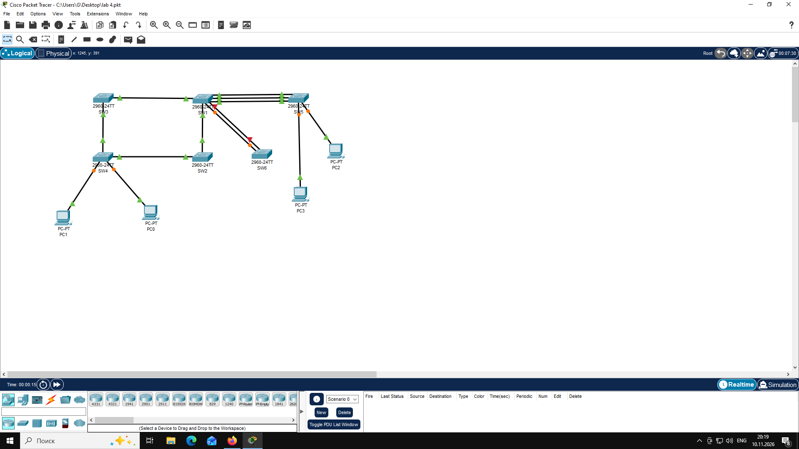

# Пример отчета

````markdown
# Отчет по лабораторной работе №N
**Тема:** Тема работы
**Выполнил:** Иванов И. И., гр. ИВТ-21  

## Топология



## Ответы на вопросы

1. Ответ на вопрос.
2. Ответ на вопрос.
Продолжение ответа.
```text
тут должен быть листинг команд
```
3. Ответ на вопрос.


````

# Теория по теме работы

1. https://nag.ru/material/43122
2. https://linkmeup.ru/blog/1190/
3. https://netacad.sadlab.su/srwe-dl/5.1.1
4. https://habr.com/ru/articles/419491/
5. https://habr.com/ru/companies/cbs/articles/330358/