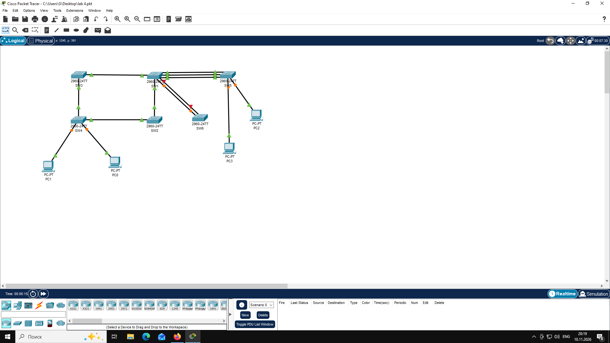

# Отчет по лабораторной работе №N
**Тема:** Тема работы
**Выполнил:** Гаврилов Ярослав, гр. 539  

## Топология



## Ответы на вопросы

1.
```text
SW1#show spanning-tree
VLAN0001
  Spanning tree enabled protocol ieee
  Root ID    Priority    32769
             Address     0001.426A.E8BB
             This bridge is the root
             Hello Time  2 sec  Max Age 20 sec  Forward Delay 15 sec

  Bridge ID  Priority    32769  (priority 32768 sys-id-ext 1)
             Address     0001.426A.E8BB
             Hello Time  2 sec  Max Age 20 sec  Forward Delay 15 sec
             Aging Time  20

Interface        Role Sts Cost      Prio.Nbr Type
---------------- ---- --- --------- -------- --------------------------------
Fa0/1            Desg FWD 19        128.1    P2p
Fa0/2            Desg FWD 19        128.2    P2p
Fa0/3            Desg FWD 19        128.3    P2p
Gi0/2            Desg FWD 4         128.26   P2p
Gi0/1            Desg FWD 4         128.25   P2p

SW2#show spanning-tree
VLAN0001
  Spanning tree enabled protocol ieee
  Root ID    Priority    32769
             Address     0001.426A.E8BB
             Cost        4
             Port        25(GigabitEthernet0/1)
             Hello Time  2 sec  Max Age 20 sec  Forward Delay 15 sec

  Bridge ID  Priority    32769  (priority 32768 sys-id-ext 1)
             Address     00D0.97C4.B68E
             Hello Time  2 sec  Max Age 20 sec  Forward Delay 15 sec
             Aging Time  20

Interface        Role Sts Cost      Prio.Nbr Type
---------------- ---- --- --------- -------- --------------------------------
Gi0/1            Root FWD 4         128.25   P2p
Gi0/2            Desg FWD 4         128.26   P2p

SW3#show spanning-tree
VLAN0001
  Spanning tree enabled protocol ieee
  Root ID    Priority    32769
             Address     0001.426A.E8BB
             Cost        4
             Port        25(GigabitEthernet0/1)
             Hello Time  2 sec  Max Age 20 sec  Forward Delay 15 sec

  Bridge ID  Priority    32769  (priority 32768 sys-id-ext 1)
             Address     00D0.D375.0D83
             Hello Time  2 sec  Max Age 20 sec  Forward Delay 15 sec
             Aging Time  20

Interface        Role Sts Cost      Prio.Nbr Type
---------------- ---- --- --------- -------- --------------------------------
Gi0/1            Root FWD 4         128.25   P2p
Gi0/2            Desg FWD 4         128.26   P2p

SW4#show spanning-tree
VLAN0001
  Spanning tree enabled protocol ieee
  Root ID    Priority    32769
             Address     0001.426A.E8BB
             Cost        8
             Port        25(GigabitEthernet0/1)
             Hello Time  2 sec  Max Age 20 sec  Forward Delay 15 sec

  Bridge ID  Priority    32769  (priority 32768 sys-id-ext 1)
             Address     00E0.A3DB.78BB
             Hello Time  2 sec  Max Age 20 sec  Forward Delay 15 sec
             Aging Time  20

Interface        Role Sts Cost      Prio.Nbr Type
---------------- ---- --- --------- -------- --------------------------------
Fa0/11           Desg FWD 19        128.11   P2p
Fa0/10           Desg FWD 19        128.10   P2p
Gi0/1            Root FWD 4         128.25   P2p
Gi0/2            Altn BLK 4         128.26   P2p

SW5#show spanning-tree
VLAN0001
  Spanning tree enabled protocol ieee
  Root ID    Priority    32769
             Address     0001.426A.E8BB
             Cost        19
             Port        1(FastEthernet0/1)
             Hello Time  2 sec  Max Age 20 sec  Forward Delay 15 sec

  Bridge ID  Priority    32769  (priority 32768 sys-id-ext 1)
             Address     0001.439D.9C64
             Hello Time  2 sec  Max Age 20 sec  Forward Delay 15 sec
             Aging Time  20

Interface        Role Sts Cost      Prio.Nbr Type
---------------- ---- --- --------- -------- --------------------------------
Fa0/2            Altn BLK 19        128.2    P2p
Fa0/11           Desg FWD 19        128.11   P2p
Fa0/3            Altn BLK 19        128.3    P2p
Fa0/1            Root FWD 19        128.1    P2p
Fa0/10           Desg FWD 19        128.10   P2p
```

Корнем топологии выбран SW1. В выводе show spanning-tree на SW1 присутствует строка This bridge is the root — это
 прямой признак того, что данный коммутатор является корневым мостом (Root Bridge).

Заблокированные (неназначенные) порты есть на двух коммутаторах — SW4 и SW5.
SW4 Gi0/2            Altn BLK 4         128.26   P2p          Роль: Altn (Alternate — альтернативный порт)
 Состояние: BLK (Blocking — блокировка)
 Причина: у SW4 два пути до корня SW1 — через SW2 (Gi0/1, cost 4) и через SW3 (Gi0/2, cost 4). Стоимости
 равны, поэтому выбор идёт по Bridge ID соседа: SW2 (00D0.97C4.B68E) меньше, чем SW3 (00D0.D375.0D83), поэтому
 корневым становится Gi0/1 (в сторону SW2), а Gi0/2 (в сторону SW3) блокируется как альтернативный путь.

SW5 Fa0/2            Altn BLK 19        128.2    P2p
Fa0/3            Altn BLK 19        128.3    P2p
Fa0/1            Root FWD 19        128.1    P2p
    Роль: Altn (Alternate) — у обоих портов

    Состояние: BLK (Blocking) — у обоих портов

    Причина: между SW1 и SW5 проложены три параллельных линка (Fa0/1–Fa0/1, Fa0/2–Fa0/2, Fa0/3–Fa0/3). Для
 построения дерева без петель достаточно одного линка. Все три линка имеют одинаковый cost (19) и одинаковый 
Bridge ID соседа (SW1). Выбор корневого порта идёт по Port ID вышестоящего коммутатора: у SW1 на всех трёх портах
 Port Priority по умолчанию 128, поэтому побеждает порт с наименьшим номером — Fa0/1 (Port ID 128.1). Соответственно
 на SW5 корневым становится Fa0/1, а Fa0/2 и Fa0/3 блокируются как альтернативные.

2. 
```text
SW1#show spanning-tree summary
Switch is in pvst mode
Root bridge for: default
Extended system ID           is enabled
Portfast Default             is disabled
PortFast BPDU Guard Default  is disabled
Portfast BPDU Filter Default is disabled
Loopguard Default            is disabled
EtherChannel misconfig guard is disabled
UplinkFast                   is disabled
BackboneFast                 is disabled
Configured Pathcost method used is short

Name                   Blocking Listening Learning Forwarding STP Active
---------------------- -------- --------- -------- ---------- ----------
VLAN0001                     0         0        0          5          5

---------------------- -------- --------- -------- ---------- ----------
1 vlans                      0         0        0          5          5
```
Ответ: Протокол STP работает в режиме PVST (Per-VLAN Spanning Tree, классический PVST+ на базе стандарта 802.1D).

3.
```text
SW2#show spanning-tree summary
Switch is in rapid-pvst mode
Root bridge for:
Extended system ID           is enabled
Portfast Default             is disabled
PortFast BPDU Guard Default  is disabled
Portfast BPDU Filter Default is disabled
Loopguard Default            is disabled
EtherChannel misconfig guard is disabled
UplinkFast                   is disabled
BackboneFast                 is disabled
Configured Pathcost method used is short

Name                   Blocking Listening Learning Forwarding STP Active
---------------------- -------- --------- -------- ---------- ----------
VLAN0001                     0         0        0          2          2

---------------------- -------- --------- -------- ---------- ----------
1 vlans                      0         0        0          2          2
```
Ответ: Теперь протокол работает в режиме rapid-pvst (Rapid PVST+, 802.1w). Сходимость сети ускоряется до секунд.


4.
```text
SW1#show spanning-tree vlan 1
VLAN0001
  Spanning tree enabled protocol rstp
  Root ID    Priority    16385
             Address     0001.426A.E8BB
             This bridge is the root
             Hello Time  2 sec  Max Age 20 sec  Forward Delay 15 sec

  Bridge ID  Priority    16385  (priority 16384 sys-id-ext 1)
             Address     0001.426A.E8BB
             Hello Time  2 sec  Max Age 20 sec  Forward Delay 15 sec
             Aging Time  20

Interface        Role Sts Cost      Prio.Nbr Type
---------------- ---- --- --------- -------- --------------------------------
Fa0/1            Desg FWD 19        128.1    P2p
Fa0/2            Desg FWD 19        128.2    P2p
Fa0/3            Desg FWD 19        128.3    P2p
Gi0/2            Desg FWD 4         128.26   P2p
Gi0/1            Desg FWD 4         128.25   P2p
```

```text
SW2#show spanning-tree vlan 10
VLAN0010
  Spanning tree enabled protocol rstp
  Root ID    Priority    16394
             Address     00D0.97C4.B68E
             This bridge is the root
             Hello Time  2 sec  Max Age 20 sec  Forward Delay 15 sec

  Bridge ID  Priority    16394  (priority 16384 sys-id-ext 10)
             Address     00D0.97C4.B68E
             Hello Time  2 sec  Max Age 20 sec  Forward Delay 15 sec
             Aging Time  20

Interface        Role Sts Cost      Prio.Nbr Type
---------------- ---- --- --------- -------- --------------------------------
Gi0/1            Desg FWD 4         128.25   P2p
Gi0/2            Desg FWD 4         128.26   P2p
```

```text
SW3#show spanning-tree vlan 20
VLAN0020
  Spanning tree enabled protocol rstp
  Root ID    Priority    16404
             Address     00D0.D375.0D83
             This bridge is the root
             Hello Time  2 sec  Max Age 20 sec  Forward Delay 15 sec

  Bridge ID  Priority    16404  (priority 16384 sys-id-ext 20)
             Address     00D0.D375.0D83
             Hello Time  2 sec  Max Age 20 sec  Forward Delay 15 sec
             Aging Time  20

Interface        Role Sts Cost      Prio.Nbr Type
---------------- ---- --- --------- -------- --------------------------------
Gi0/1            Desg FWD 4         128.25   P2p
Gi0/2            Desg FWD 4         128.26   P2p
```

5.
На SW5 один порт выбран корневым для всех VLAN — это порт с наименьшим Port ID вышестоящего коммутатора
 (SW1) при равных cost и Bridge ID соседа. По умолчанию порты Fa0/1, Fa0/2, Fa0/3 имеют одинаковый cost
 (19) и одинаковый Bridge ID соседа (SW1), поэтому выбор идёт по Port ID вышестоящего
 (Port Priority + номер порта). У SW1 по умолчанию Port Priority 128 на всех портах, значит побеждает
 порт с наименьшим номером — Fa0/1 на SW1. Соответственно на SW5 корневым становится порт, подключённый
 к Fa0/1 SW1 — это Fa0/1 SW5.

Коммутатор выбирает корневой порт при равных BPDU: порядок сравнения:
 Наименьший Root Path Cost.
 При равенстве — наименьший Bridge ID соседа.
 При равенстве — наименьший Port ID соседа (Port Priority + номер порта).
 При равенстве — наименьший локальный Port ID.

6.
```text
SW5#show spanning-tree
VLAN0001
  Spanning tree enabled protocol rstp
  Root ID    Priority    16385
             Address     0001.426A.E8BB
             Cost        19
             Port        1(FastEthernet0/1)
             Hello Time  2 sec  Max Age 20 sec  Forward Delay 15 sec

  Bridge ID  Priority    32769  (priority 32768 sys-id-ext 1)
             Address     0001.439D.9C64
             Hello Time  2 sec  Max Age 20 sec  Forward Delay 15 sec
             Aging Time  20

Interface        Role Sts Cost      Prio.Nbr Type
---------------- ---- --- --------- -------- --------------------------------
Fa0/2            Altn BLK 19        128.2    P2p
Fa0/3            Altn BLK 19        128.3    P2p
Fa0/1            Root FWD 19        128.1    P2p

VLAN0010
  Spanning tree enabled protocol rstp
  Root ID    Priority    16394
             Address     00D0.97C4.B68E
             Cost        23
             Port        2(FastEthernet0/2)
             Hello Time  2 sec  Max Age 20 sec  Forward Delay 15 sec

  Bridge ID  Priority    32778  (priority 32768 sys-id-ext 10)
             Address     0001.439D.9C64
             Hello Time  2 sec  Max Age 20 sec  Forward Delay 15 sec
             Aging Time  20

Interface        Role Sts Cost      Prio.Nbr Type
---------------- ---- --- --------- -------- --------------------------------
Fa0/2            Root FWD 19        128.2    P2p
Fa0/3            Altn BLK 19        128.3    P2p
Fa0/1            Altn BLK 19        128.1    P2p
Fa0/10           Desg FWD 19        128.10   P2p

VLAN0020
  Spanning tree enabled protocol rstp
  Root ID    Priority    16404
             Address     00D0.D375.0D83
             Cost        14
             Port        3(FastEthernet0/3)
             Hello Time  2 sec  Max Age 20 sec  Forward Delay 15 sec

  Bridge ID  Priority    32788  (priority 32768 sys-id-ext 20)
             Address     0001.439D.9C64
             Hello Time  2 sec  Max Age 20 sec  Forward Delay 15 sec
             Aging Time  20

Interface        Role Sts Cost      Prio.Nbr Type
---------------- ---- --- --------- -------- --------------------------------
Fa0/2            Altn BLK 19        128.2    P2p
Fa0/11           Desg FWD 19        128.11   P2p
Fa0/3            Root FWD 10        128.3    P2p
Fa0/1            Altn BLK 19        128.1    P2p
```
VLAN1 — корневой порт Fa0/1 (наименьший Port ID вышестоящего по умолчанию).
VLAN10 — корневой порт Fa0/2 (благодаря port-priority 112 на Fa0/2 SW1 — меньше 128, выигрывает по Port ID соседа).
VLAN20 — корневой порт Fa0/3 (благодаря cost 10 — минимальная стоимость пути).

7.
Для перевода магистрального интерфейса в режим PortFast используется команда:
```text
interface <intf>
spanning-tree portfast trunk
```
Когда можно: только на trunk-портах, где на другом конце заведомо нет коммутатора — например,
 router-on-a-stick (подключение маршрутизатора с саб-интерфейсами), trunk-адаптер сервера/гипервизора,
 точка доступа с trunk-портом.

Когда строго не рекомендуется: на trunk-портах, соединяющих коммутаторы — это может привести к
 образованию петли, так как PortFast переводит порт в Forwarding без участия STP, обходя расчёт дерева.

8.
```text
SW1#show interface Fa0/4
FastEthernet0/4 is down, line protocol is down (err-disabled)
  Hardware is Lance, address is 0040.0be1.7104 (bia 0040.0be1.7104)
 BW 100000 Kbit, DLY 1000 usec,
     reliability 255/255, txload 1/255, rxload 1/255
  Encapsulation ARPA, loopback not set
  Keepalive set (10 sec)
  Full-duplex, 100Mb/s
  input flow-control is off, output flow-control is off
  ARP type: ARPA, ARP Timeout 04:00:00
  Last input 00:00:08, output 00:00:05, output hang never
  Last clearing of "show interface" counters never
  Input queue: 0/75/0/0 (size/max/drops/flushes); Total output drops: 0
  Queueing strategy: fifo
  Output queue :0/40 (size/max)
  5 minute input rate 0 bits/sec, 0 packets/sec
  5 minute output rate 0 bits/sec, 0 packets/sec
     956 packets input, 193351 bytes, 0 no buffer
     Received 956 broadcasts, 0 runts, 0 giants, 0 throttles
     0 input errors, 0 CRC, 0 frame, 0 overrun, 0 ignored, 0 abort
     0 watchdog, 0 multicast, 0 pause input
     0 input packets with dribble condition detected
     2357 packets output, 263570 bytes, 0 underruns
     0 output errors, 0 collisions, 10 interface resets
     0 babbles, 0 late collision, 0 deferred
     0 lost carrier, 0 no carrier
     0 output buffer failures, 0 output buffers swapped out
```
Ответ: Интерфейс находится в состоянии err-disabled (административно выключен из-за срабатывания защиты).
Событие: На порту Fa0/4 SW1 настроен BPDU Guard. При подключении SW6 через этот порт от SW6 начали приходить
 BPDU-кадры. BPDU Guard воспринял это как нарушение (на порту, защищённом BPDU Guard, не должно быть коммутатора)
 и немедленно перевёл порт в err-disabled.

9.
```text
SW1#show spanning-tree inconsistentports
Name                 Interface            Inconsistency
-------------------- -------------------- ------------------
VLAN0001             FastEthernet0/5      Root Inconsistent

Number of inconsistent ports (segments) in the system : 1
```
В списке несогласованных портов присутствует интерфейс FastEthernet0/5 (Fa0/5) коммутатора SW1
 в VLAN 1. Состояние несогласованности — Root Inconsistent.
Интерфейс Fa0/5 на SW1 перешёл в состояние root-inconsistent в результате срабатывания механизма
 Root Guard, настроенного на этом порту командой spanning-tree guard root.

Последовательность событий:
На коммутаторе SW6 был задан приоритет STP для VLAN1 равным 4096 командой spanning-tree vlan 1 priority 4096.
 С учётом Extended System ID (VLAN ID = 1) Bridge ID SW6 стал равен 4097, что меньше Bridge ID текущего корневого
 моста — SW1 (16384 + 1 = 16385). Тем самым SW6 начал заявлять себя более предпочтительным кандидатом 
на роль корня.
Было установлено физическое соединение между портом Fa0/5 коммутатора SW1 и портом Fa0/2 коммутатора SW6.
После поднятия линка SW6 начал отправлять через порт Fa0/2 в сторону SW1 BPDU с более выгодным
 (меньшим) Bridge ID = 4097, претендуя на роль корневого моста.
На порту Fa0/5 SW1 настроен Root Guard. Получив более выгодный BPDU от соседа, который пытается
 стать корнем, Root Guard не допустил захвата роли корня через данный порт и перевёл порт в состояние
 root-inconsistent — блокировку на уровне STP. Порт перестал участвовать в выборах корня и передаче
 трафика VLAN1, однако физически остался включённым.

Таким образом, событием, приведшим интерфейс Fa0/5 в состояние root-inconsistent, является получение
 на порту с настроенным Root Guard более выгодного BPDU от коммутатора SW6, у которого приоритет STP
 для VLAN1 равен 4096. Root Guard предотвратил захват периферийным коммутатором роли корневого моста. 
Состояние root-inconsistent снимается автоматически после прекращения поступления более выгодных BPDU 
(например, при отключении линка или повышении приоритета SW6).